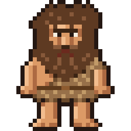

# Klod Talk

**Cave Talk** is a Claude Code mod. A side pane retells Claude's answers in
caveman speak. Beside it stands Klod, a pixel caveman whose pose follows what
Claude is doing: he hunts while Claude searches, carves while it edits, and
panics when a test fails. It is a joke, not a tool, and it never changes what
Claude does.



**Status:** Phase 1 is built: the pane, Klod's nine core poses (Idle,
Impatient, Thinking, Snack, Explaining, Happy, Shrug, Panic, Sleep) and the cave
translation. Every tool shows Thinking until Phase 2.

## Install

Mods show in the terminal and in the Code tab of the Claude Desktop app, with
Claude Code 2.1.287 or later. This repository is its own plugin marketplace, so
one line installs the mod. Type it at the prompt of a Claude Code session in a
terminal:

```
/plugin install cave-talk --marketplace rpc5102/klod-talk
```

Answer `y` to add the marketplace, pick a scope (user installs it everywhere),
and set the options or keep the defaults. Then type `/klod`. Installed from a
terminal at the user scope, it also loads in the desktop app's Code tab.

That line installs what is on `main`. To try a branch Claude is still working
on, add `#` and the branch name to the marketplace:

```
/plugin install cave-talk --marketplace rpc5102/klod-talk#claude/phase-1-build-vryqol
```

The pane opens by itself in a fullscreen terminal 144 columns or wider. The cave
level, the translation model and "Open at start" are in `/config`.

In Ghostty and kitty, which show real images, Klod is drawn as one at 16 by 8
cells with every pixel. Other terminals draw him in half-block characters at 32
by 16 cells.

### Getting a new phase

`plugin.json` has no `version` on purpose: an install follows the commits of
the branch it came from. To pick up new work, run this in your shell, then
`/reload-plugins` in any session that is open:

```bash
claude plugin update cave-talk@klod-talk
```

Or turn on auto-update for the marketplace under Marketplaces in `/plugin`.

### Working on the mod

From a clone, `claude --plugin-dir /path/to/klod-talk` loads your working copy
instead, with hot reload. It replaces an installed copy of the same name for
that session, so there is no need to uninstall.

## Backlog

Open work, checks to try by hand, and decisions waiting on Bob are
[GitHub issues](https://github.com/rpc5102/klod-talk/issues), labelled by phase
and kind (`check by hand`, `needs decision`, `question`).

## What's here

| Path | What it holds |
| --- | --- |
| [docs/build-notes.md](docs/build-notes.md) | The spec: architecture, the pose director, the translator, and four phases |
| [docs/mockups/](docs/mockups/) | Pictures of the design boards, listed by phase |
| [docs/prototypes/](docs/prototypes/) | Scene data from the clickable prototypes: timings, cave text, chip and poke lines |
| [docs/reference/](docs/reference/) | The starting word list, sample translations, and the script that paints Draw it pictures |
| [kit/](kit/) | Klod's sprite kit: 28 poses, the source of every frame |
| [CLAUDE.md](CLAUDE.md) | How Claude Code sessions build this repo |
| `.claude-plugin/`, `hooks/`, `types/` | The mod: its manifest, the marketplace file that lists it, its hooks module and parts, and its `$.state` contract |
| `assets/frames/` | Every frame as a 256 by 256 PNG, which Ghostty and kitty read to draw Klod |
| [scripts/](scripts/) | Generate `hooks/catalog.ts`, `hooks/words.ts`, `assets/frames/` and `tests/fixtures.ts` from the data above |
| [tests/](tests/) | Unit tests and engine scenarios for `claude plugin test` |

## Checking a change

```bash
node scripts/gen-catalog.mjs --check   # and gen-words, gen-frames, gen-fixtures: generated files are current
claude plugin validate .
tsc -p .                               # needs the types Claude Code lays in .claude-plugin/types/
claude plugin test .
```

Claude Code writes `.claude-plugin/types/` each time an interactive session
loads the mod with `--plugin-dir`, so run the mod once before the type check.
The folder is not committed.

## Building it with Claude Code

Each phase is one Claude Code session, started from the Code tab in the Claude
app, on the web, or with `claude --cloud`. Pick this repo and send:

> Read CLAUDE.md, then build Phase 1 from docs/build-notes.md. When validate,
> the type check and the tests all pass, push the branch and tell me how to try
> it on my computer.

For later phases, change the phase number. Choose Plan mode first if you want
to approve the plan before any code is written.

## License

MIT. See [LICENSE](LICENSE).
