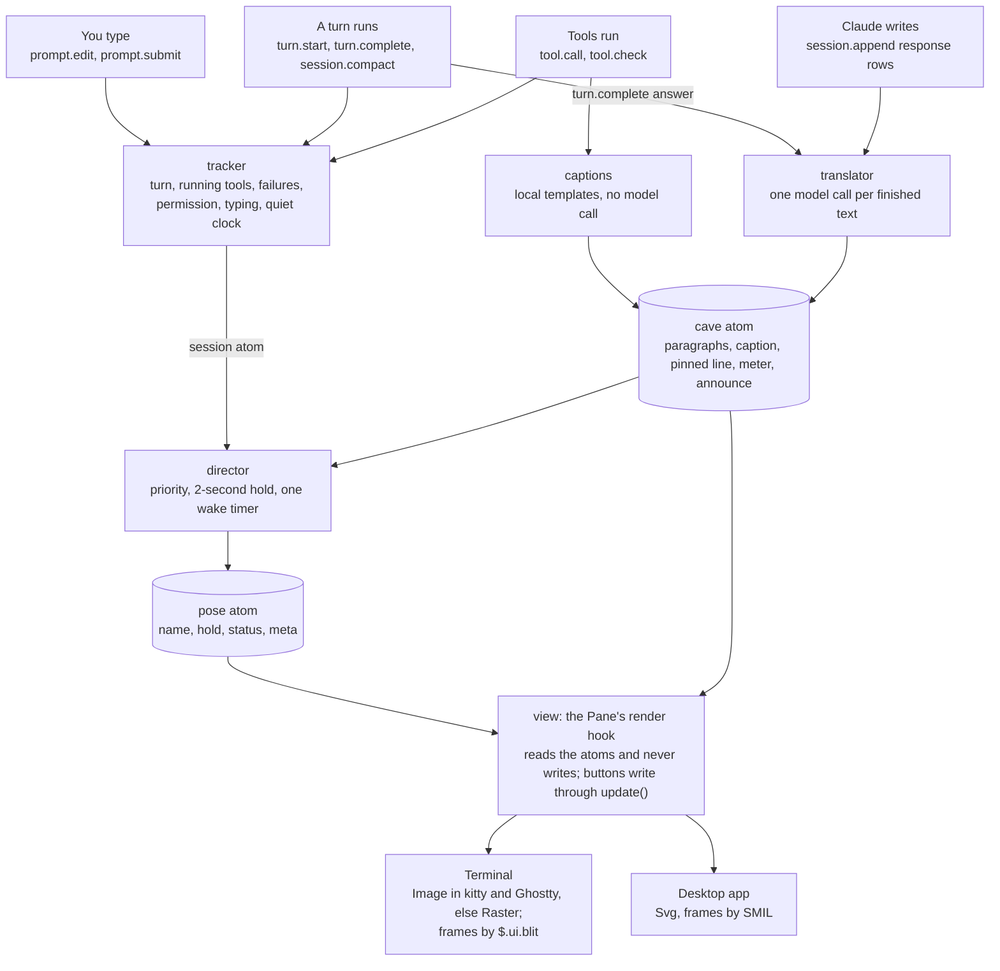

# Cave Talk mod: build notes

> This is a copy of the build notes kept in Claude Docs, exported on Oct 10, 2026. It is the spec for build sessions in this repo; Bob approves changes to it. The design canvas linked below needs a claude.ai sign-in, so pictures of its boards are in [mockups/](mockups/) and the prototypes' scene data is in [prototypes/](prototypes/).

Oct 9, 2026 · @Bob Carey · updated Oct 11, 2026 with the decisions made while building and trying Phase 1

## Overview

Cave Talk is one TypeScript mod for Claude Code: a side pane that retells Claude's answers in caveman speak, beside Klod, a pixel caveman whose pose follows the session. It is a joke, not a tool, so nothing in it may change what Claude does.

Decisions already made:

- **All in the mod.** One hooks module on Claude Code's mod API draws the pane, watches the session, runs the timers and makes the translation call. No helper process.
- **Pseudo-code, then code.** Phase 1 is built from these notes. Where building or trying it changed a decision, the text below says so.
- **Phased, MVP first.** Phase 1 ships the pane, the translation and nine core poses. Phases 2 to 4 add tool poses, personality, edge cases and settings.
- **Sprites come from the kit.** A build script turns the kit's `caveman.json` (28 poses, frames and timings) into code the mod imports, and another paints its frames as PNGs for terminals that show real images. The mod never redraws them.
- **Installed from this repo.** The repository is its own plugin marketplace: `/plugin install cave-talk --marketplace rpc5102/klod-talk`, with `#<branch>` after the repo to try a work branch. `plugin.json` sets no `version`, so an install follows the commits of the branch it came from and picks up a new phase with `claude plugin update cave-talk@klod-talk`.
- **The [design canvas](https://claude.ai/artifact/EbGXhRDE8qw6UjgnKXjNCJ) is the spec.** Where these notes and a board disagree, the newest round wins, except where the mod API forces a change; those are called out.

Read it in order: the architecture and data shapes, then the two engines everything leans on (the pose director and the translator), then the phases in build order. It closes with what we're not doing and the questions to settle against the mod API before any real code.

## Architecture

One hooks module in six small parts. Hooks feed a session tracker; a pose director and a translator decide what the pane shows; one render hook draws it from `$.state`. The mod is the repository itself, laid out as Phase 1 built it:

```text
klod-talk/
  .claude-plugin/plugin.json       name cave-talk, no version, userConfig (cave level, open at start, translation model)
  .claude-plugin/marketplace.json  the repo as a marketplace: cave-talk, source "./"
  hooks/hooks.json                 { "modules": ["./register.tsx"] }
  hooks/register.tsx               wires events to the parts; declares the atoms and builds the port from $
  hooks/port.ts                    what the parts may do outside themselves: every call on $, as closures
  hooks/tracker.ts                 session facts: turn, running tools, failures, quiet clock
  hooks/director.ts                picks the pose: priority, holds, exceptions, timers
  hooks/translator.ts              cave translation: queue, model call, paragraphs
  hooks/reply.ts                   what is sent and what comes back: fences out, SIZE, JOKES OFF, *terms*
  hooks/captions.ts                local tool captions from name, args, result, word list (Phase 2)
  hooks/view.tsx                   the Pane's drawing, per surface
  hooks/sprites.ts                 caveman.json to Raster cells or image frames (terminal) or SVG (desktop)
  hooks/catalog.ts, words.ts       generated from kit/caveman.json and docs/reference/words.json
  hooks/atoms.ts, settings.ts      the atoms' first values; the options as the mod reads them
  hooks/lane.ts                    the one lane every background write goes through, in order
  types/index.d.ts                 PluginState contract: every $.state value
  kit/caveman.json                 the sprite kit, unchanged; it stays in kit/
  docs/reference/words.json        the word list ("Timezone" = "which cave you live in")
  assets/frames/                   every frame as a 256 by 256 PNG, for terminals that show images
  assets/sounds/                   grunts, Phase 3
  scripts/                         gen-catalog, gen-words, gen-frames, gen-fixtures; their output is committed
  tests/                           *.test.ts for claude plugin test
```

| Part | Owns | Reads | Writes |
| --- | --- | --- | --- |
| tracker | what the session is doing now | hook events | `session` atom, the only writer |
| director | the pose, and when it may change | `session` and `cave` atoms, clock | `pose` atom |
| translator | the cave words | the turn's answer, cave level | `cave` atom; flags jokes off through the tracker |
| captions | one-line tool captions | tool name, args, result, word list | `cave.caption` |
| view | the pane | `pose`, `cave`, `settings`, `display` | nothing: render hooks never write |
| sprites | frames as cells, image files or SVG | the generated catalog, the `display` atom | the frame last shown, in a module variable; `display` when a terminal turns out to show no images |

Five rules hold everywhere:

- **Never change what Claude does.** Every hook on Claude's own events ends in `return next(e)` with `e` untouched, and no command answers with text the model would read. Cave Talk only watches.
- **Drawn state lives in `$.state`.** Module variables are lost on a hot reload; atoms are not. The view never reads the `session` atom, which changes on every keystroke.
- **Render hooks only read.** Events and button handlers write, through `update($, atom, fn)`.
- **Every reload is a restart.** `session.start` runs again on each reload (and `$.config.set` reloads), with every timer cancelled. It fills only atoms that are still empty, then restarts the wake timer, the sprite's frames and any translation that was chewing. A /clear ends the session with no new start, so `session.end` with reason `clear` resets the facts.
- **`$` stays in register.tsx.** The engine reads the hooks module's source to learn what it calls. It follows `$` only into functions declared in the module's own file, never across an import, and lists an atom only when the atom is a const there. So `register.tsx` declares the atoms and builds a port: closures over `$`, each call spelled out (`$.clock.now()`, `$.model.complete(...)`, `$.ui.blit(...)`). The parts take the port, never `$`, and the view gets the surface's elements and its actions passed in.



*Hooks feed the atoms; the pane only reads them. Every hook passes Claude's events on unchanged.*

Tinted boxes are `$.state` atoms. The session atom rides the arrow from tracker to director, a fourth, `settings`, only mirrors the options, and a fifth, `display`, records how the terminal draws Klod. Nothing points back into Claude Code.

## Data shapes

The pane draws from five atoms under the plugin name `cave-talk`, declared once in `types/index.d.ts`. Settings mirror the `userConfig` options; the word list and the Wall's paintings persist in `$.store`. Every field `desired()` reads is declared here.

```text
Catalog        hooks/catalog.ts, generated from the kit's caveman.json
  palette         char -> 0xRRGGBB
  poses           PoseName -> { frames: Grid[], durationsMs: int[], description }
  Grid            32 strings of 32 chars, '.' is transparent

SessionFacts   atom 'session'     the tracker is its only writer
  turn            { id, startedAt, testRuns, failedBefore, lastRunFailed, isBigWin } or null
  running         [{ toolUseId, tool, kind, summary, startedAt }]   main loop only
  lastTool        { kind, endedAt, isError, wasDenied }
  permissionWait  { tool, since } or null      a dialog is up
  result          { pose: campfire | happy | shrug, asksUser, endedAt } or null
  panicUntil      time; Panic shows at least 2 s
  ownBeats        queue of { name, lengthMs }: failed, poke, chip reaction, paint
  moments         queue of { name, lengthMs }: forget, suspicious, facepalm
  fidget          { dueAt, last, nextLine per fidget }
  typingAt        time of the last prompt.edit, or null
  quietSince      time of the last real event
  jokesOff, modelDown, apologies, lastSuspicious

PoseState      atom 'pose'        director writes, view reads
  name, since, holdUntil          when it started, earliest it may change
  beatUntil       a beat's end, counted from when it was first shown
  status, meta    the top line and the plain-words line under it

CaveWords      atom 'cave'        translator and captions merge into it, never replace it
  source          { id, text, level }  kept for Again, level changes and reloads
  phase           'empty' | 'chewing' | 'streaming' | 'done' | 'failed'
  paragraphs      Segment[][]     Segment = { text, isTerm }
  shown, skipped  paragraphs revealed; older answers dropped while chewing
  explainedAt     when the last paragraph landed
  pinned          first line of the last translation, kept during tool beats
  caption         the current tool caption, or null
  mammoths        0 to 5, set only when a translation lands
  glossary        [term, cave word] pairs on screen now
  announce        text for screen readers, set once per answer
  problem         why the last translation failed, in plain words, or null

Settings       atom 'settings'    a copy of the userConfig options (rows in Phase 4)
  level, when, copyTools, poke, wall, noJokes, grunts, motion, size, textOnly, autoOpen, model
                  Phase 1 declares level, autoOpen and model; Phase 4 adds the rest

DisplayFacts   atom 'display'     set once per session, at its first start
  terminalArt     'image' in kitty and Ghostty, 'cells' in every other terminal
```

`ToolKind` is decided once per call, from the tool's name and arguments: `read`, `search`, `edit`, `web`, `test`, `build`, `deploy`, `install`, `other`. Bash commands that search (`rg`, `grep`, `find`) are `search`, since native builds have no Grep or Glob tool. Everything downstream switches on the kind, never on raw command strings.

## The pose director

The director turns session facts into one pose at a time with three rules: the louder trigger wins, every pose holds 2 s, and quiet steps down to Idle, fidgets and Sleep. It is level-triggered: it asks what should show now, so missed poses are skipped, never replayed.

When two triggers fire at once, the higher one wins:

1. Panic: an error, a failing test, a crash
2. Sign: a permission dialog is waiting
3. Snack, Explaining, Paint: Cave Talk's own beats (Facepalm opens Explaining)
4. Forget, Suspicious, Bonk, then the tool poses (Buried for installs)
5. Thinking
6. Shrug, Campfire, Happy: the turn's result
7. Impatient, Idle (and its fidgets), Sleep

```text
function desired(facts, cave, now) -> Want
  if facts.jokesOff                    -> sign, in plain words, if facts.permissionWait; else idle, still
  if now < facts.panicUntil            -> panic
  if facts.permissionWait              -> sign
  if cave.phase == 'chewing'           -> snack
  if cave.phase == 'streaming'
     or now < cave.explainedAt + 2 s   -> explaining; facepalm for its first 2 s after an apology
  if facts.ownBeats                    -> the first: shrug (failed), poke reaction, chip reaction, paint
  if facts.moments                     -> the first: forget | suspicious | facepalm
  if newest running tool               -> toolPose(tool, now)
  if facts.turn                        -> thinking
  if facts.result and (now < result.endedAt + 60 s or result.asksUser)
                                       -> campfire | happy | shrug
  if facts.typingAt > now - 1.5 s      -> impatient
  if now >= facts.quietSince + 20 min  -> sleep
  if now >= facts.fidget.dueAt         -> fidget (two loops, then idle)
  otherwise                            -> idle

function toolPose(tool, now)
  age = now - tool.startedAt           counted from when its dialog closed, if it asked
  if tool.kind == 'install' and age > 10 s   -> buried
  if tool is Bash and age > 30 s             -> dance        any command past 30 s
  if tool.kind in test, build, deploy        -> flint
  if tool.kind == 'edit'                     -> bonk if the last test or build run failed, else carve
  if tool.kind in read, search, web          -> read | hunt | shout
  if age > 5 s                               -> pilates
  otherwise                                  -> thinking

function evaluate()                    on every fact change and from the wake timer
  want = desired(facts, cave, now)
  if want is the pose on screen: return
  if now < pose.holdUntil and not breaksHold(want, pose): wakeAt(pose.holdUntil); return
  setPose(want, holdUntil = now + 2 s)
  if want is a beat: its clock starts now; it leaves its queue when its time is up
  wakeAt(next moment the answer could change: a hold or a beat ending, a tool
         crossing 5, 10 or 30 s, 60 s after a turn, the next fidget, 20 minutes)

function breaksHold(want, current)     the three exceptions
  want is panic                        cuts in at once, even mid-hold
  current is snack and the words arrived
  current is a fidget and want is anything real
```

The end of a turn always runs the same way:

1. The turn completes on the main loop with reason `answer`, and its answer goes to the translator. Snack while the translation chews; it ends the moment the words arrive.
2. Explaining while the paragraphs stream, for at least 2 s.
3. The result, once the last paragraph is in: Campfire for a big win (a deploy that worked, a merged PR), Happy if everything passed, Shrug if Claude asked you something or the last test or build run failed.
4. The result holds 60 quiet seconds, then Idle. A question for you keeps Shrug up until you answer.

Other endings are short: an interrupted turn goes straight to Idle, an API error shows Panic and then Shrug, and a refusal shows Shrug.

Quiet time steps down on its own: Idle from 60 s after a turn or the session opening, a fidget every 2 to 4 minutes (never the same one twice, two loops each, its lines taking turns), Sleep at 20 minutes. Every real event cuts a fidget off and reschedules the next one, and the next keystroke wakes him up Impatient. One `$.clock.after` wake timer is enough; nothing polls.

## Translation pipeline

Each turn's answer gets one `$.model.complete` call that returns cave paragraphs. The pane chews for about a second (the call), then shows one paragraph every 0.6 s.

- **Trigger.** `turn.complete` on the main loop (no `agentId`) with reason `answer`: its `answer` is Claude's final visible text. Subagents' turns pass straight through. Phase 2 adds mid-turn text over 40 words from `session.append` response rows, so a real explanation gets translated and "Let me run the tests." does not.
- **What is sent.** The answer with fenced code blocks taken out. Inline code stays, so terms like `date.today` can be emphasised. Tool output is never sent; captions are built locally.
- **One call at a time.** One call is in flight and one text waits. A newer text replaces the waiting one, or aborts the call in flight through `options.signal`; the pane counts it as "1 older answer skipped". Hooks never await the translator, because appends are stored in order.
- **Literal rock costs nothing.** That level answers "Rock." locally, with no model call.
- **The same call decides jokes off.** If the answer is about real damage (lost data, a security incident, an outage that hurts people), the model answers `JOKES OFF`. From then on the translator and the captions stop, and each answer gets one sober line.
- **Low effort.** The call asks for `effort: 'low'`. At the model's default effort a real answer took about 5 s and up to 1,000 output tokens, most of them hidden thinking, close to the 8 s timeout; at low effort the same answer took about 1.4 s and 170 tokens, the second of chewing above.
- **Failure is a beat, not an error.** A blocked model or a bad request rejects; `isAnswered: false` covers an API error, an empty reply or the 8 s timeout. Either way the pane shows Shrug and "Me brain hurt.", with Try now. The plain-words line under it says why, from the cave atom's `problem`: "Translation failed: API error 404, model not found", "no reply within 8 s", "the call was refused (…)", "the model sent back no words", "the reply had no words in it". The debug log has the same reason with the model and the time taken. An abort because the person pressed Esc is skipped quietly. Claude's answer is untouched either way.

```text
on turn.complete(e)
  r = await next(e)                                 unchanged
  if not e.agentId
    tracker.turnEnded(e.reason, now)
    if e.reason == 'answer' and e.answer: translator.offer(e.answer, e.turnId)   not awaited
  return r

translator.offer(text, id)
  if jokesOff: merge cave { one sober line }; return
  latest = id
  if level == 'rock': merge cave { phase: 'done', paragraphs: ["Rock."] }; return
  if when == 'long only' and words(text) <= 120: return      the pinned line stays
  if a call is in flight: waiting = { id, text }; abort it; cave.skipped += 1; return
  run({ id, text, level })

translator.run(job)
  merge cave { source: job, phase: 'chewing', problem: null }
  try r = await $.model.complete({ model, system: FIXED (one cache mark at its end),
                                   prompt: levelNote(job.level) + withoutFences(job.text),
                                   maxTokens: 500, timeoutMs: 8000, effort: 'low' }, { signal })
  catch err: failed('the call was refused (' + err + ')'); return   blocked model, bad request
  if job.id != latest: run(waiting) if any; return    a newer text won
  if not r.isAnswered
    if r.reason == 'aborted' and the person pressed Esc: return
    failed(why r.reason); return                      Shrug beat, "Me brain hurt.", the reason under it
  out = parse(r.text)                                 SIZE line, JOKES OFF, paragraphs, *terms*
  if out.jokesOff: tracker.jokesOff(); merge cave { one sober line }; return
  cancel the previous reveal timer
  merge cave { phase: 'streaming', paragraphs: out.paragraphs, shown: 1,
               mammoths: out.size, glossary: terms on screen }
  every 600 ms: shown += 1; at the last one phase = 'done', explainedAt = now,
                announce = status + all paragraphs (once per answer)
  run(waiting) if any
```

The fixed part of the prompt comes first and carries the one cache mark. If it is under the model's cache minimum, both cache counts in `usage` read zero, which is harmless. On Bedrock, Vertex or behind a gateway, lead `prompt` with the fixed text instead of `system`.

```text
FIXED (one cache mark at its end)
  You retell a coding assistant's message as a grumpy, lovable caveman.
  Same facts, same order, same numbers. Never add a cause, a fix or a promise the text does not make.
  Short words. "Me", "you", no articles. One to five short paragraphs.
  Use the word list's cave word for each of its terms, wrapped in *asterisks*.
  First line: SIZE n, from 0 (nothing wrong) to 5 (everything on fire).
  If the text is about real harm (lost data, a security incident, an outage hurting people),
  answer only: JOKES OFF
  Word list: Timezone = which cave you live in; UTC = cave with no window;
  CI = far away test cave; Permission = ask nice; ...
PROMPT
  Level: caveman. Text: <the answer, fences removed>
```

| Level | How | Model call |
| --- | --- | --- |
| Less cave | light grammar, most words kept | yes |
| Caveman | the default voice | yes |
| Very caveman | shorter, louder | yes |
| Literal rock | "Rock." | no |

## Phase 1: MVP

Phase 1 ships the pane, the translation and nine poses, enough to watch one real turn from prompt to answer: Idle, Impatient, Thinking, Snack, Explaining, Happy, Shrug, Panic and Sleep. Every tool shows Thinking until Phase 2.

Ship the kit as code, not files: a small script turns `caveman.json` into `hooks/catalog.ts` (`export const CATALOG = ...`), because a hooks module imports only script files. The word list ships the same way, as `hooks/words.ts`.

```text
export register(on, options)
  on session.start                       also after every reload, with timers cancelled
    $.command.register({ name: 'klod', description: 'Open Cave Talk', immediate: true })
    fill atoms that are still empty; settings = options
    if display is still empty: terminalArt = 'image' where TERM, TERM_PROGRAM or
      KITTY_WINDOW_ID names kitty or Ghostty, else 'cells'
    director.evaluate(); sprites.restart()          from what $.state holds
    if cave was chewing, or cave.source.level != settings.level
      translator.run(cave.source at settings.level)   the reload dropped the call
    return next(e)

  on ui.render { component: 'AbovePrompt' }          a pass-through that opens the pane once
    if options.autoOpen and e.viewport?.isFullscreen and not opened yet
      $.ui.open({ id: 'cave', title: 'Cave Talk', rows })   unasked: placed from 144 columns
    return next(e)

  on command.run { command: 'klod' }
    $.ui.open({ id: 'cave', title: 'Cave Talk', rows })   asked: placed at any width
                                                       rows inline: 16 with the image, 24 with cells
    return {}                                          no text: the model reads command output

  on prompt.edit        tracker.typed(now);            return next(e)
  on prompt.submit      tracker.prompted(now);         return next(e)
  on turn.start         tracker.turnStarted(e.turnId); return next(e)
  on tool.call          if e.agentId: return next(e)   main loop only
                        tracker.toolStarted(e)
                        ran = await next(e)
                        tracker.toolEnded(e, ran)       ran.isError, ran.deny, ran.text
                        return ran                      unchanged
  on turn.complete      (Translation pipeline)
  on session.end        if e.reason == 'clear': tracker.reset(); clear the cave atom
                        return next(e)
  on ui.render { component: 'Pane', requestId: 'cave' }   view.draw($, e)

view.draw($, e)
  { Box, Text, Button, Select } = $.ui.resolve(e)
  pose = read(pose); cave = read(cave); settings = read(settings)     never read(session)
  Box column, sized to e.props.bodyColumns
    Box row
      sprite(e.surface, pose)          the frame last shown, so a redraw never restarts him
      Box column: Text bold {pose.status}; Text dim {pose.meta}
    if cave.phase == 'chewing': Text dim "Me chew big words..."
    for each shown paragraph: Text, terms bold in the accent colour
    Box row
      Select key 'level', label 'Cave level' -> $.config.set({ key: 'cave-talk.level', value })
                                       none on mobile, which has no Select and draws no panes today
      Button 'Again' -> translator.run(cave.source)
      Button 'Copy'  -> $.ui.copy({ text, surface: e.surface })   terminal only
```

A level change goes through `$.config.set`, which reloads the module; `session.start` then translates `cave.source` again at the new level. Copy is terminal-only for now, because a remote surface has no clipboard path yet.

The sprite is drawn three ways, from the same catalog:

- **Terminal, in Ghostty and kitty: `Image`, 16 columns by 8 rows.** These terminals show real images, so Klod keeps every pixel at half the cells (Bob found 32 by 16 too large). `scripts/gen-frames.mjs` paints every frame from `caveman.json` as a 256 by 256 PNG in `assets/frames/`, eight screen pixels to a sprite pixel, so he is crisp at 1x and on a 2x display, and the terminal reads the files itself. The same chain of timers swaps frames with `$.ui.blit({ requestId: 'cave', key: 'sprite', source: { file, format: 'png' } })`. The `alt` is the pose's description. Which terminal it is comes from `TERM`, `TERM_PROGRAM` and `KITTY_WINDOW_ID`, once per session, kept in the `display` atom; a blit refused because the terminal draws the `alt` in the picture's place (tmux, ssh) switches to cells for the rest of the session.
- **Terminal, everywhere else: `Raster`, 32 columns by 16 rows.** Smaller isn't possible there without losing pixels: a cell is the smallest thing these terminals colour, and half blocks already put two pixels in each, so a 16 by 8 version has to merge pixels and his face goes. Each cell packs two pixels. It is `▀` (top colour over bottom colour) when the top pixel is opaque, `▄` in the bottom colour when only the bottom one is, and a space when neither is; empty colours are the terminal's default, `0x01000000`. A chain of `$.clock.after(durationMs)` timers calls `$.ui.blit({ requestId: 'cave', key: 'sprite', cells })`, and the render hook always draws the frame last shown.
- **Desktop app: `Svg`, drawn as an image.** It was `isInteractive: true` at first, which draws it in a sandboxed frame. In the app's dark mode the frame painted a white box behind him, and a click in the pane redrew it and reloaded the frame, so he flickered. As a plain image he has neither. One SVG per pose holds every frame as a group, and a looping SMIL `<animate>` on each group's `visibility` (`calcMode="discrete"`, `keyTimes` from the kit's durations) switches them. The surface animates it, so the engine never redraws per frame. Merge same-colour runs into one `<rect>` to stay well under 131,072 characters; `alt` is the pose's description. The same path would cover VS Code and the phone, whose element tables the types already declare, but Claude Code's mods docs say neither draws a mod's panes today.

Done when:

- [x] `claude plugin validate` and `tsc -p` are clean
- [ ] A real turn in a 160-column fullscreen terminal runs Thinking, Snack, Explaining, Happy, and the cave words stream in
- [ ] Again gives a new take; a level change translates the same answer again
- [ ] `/klod` opens the pane inline in an 80-column terminal
- [ ] The desktop app shows the same turn, the sprite animating
- [x] A broken model name gives Shrug and "Me brain hurt.", and Claude's answer is untouched (checked in a headless session with `ANTHROPIC_DEFAULT_HAIKU_MODEL` set to a model that doesn't exist)
- [ ] A hot reload keeps the pane, the pose and the words, and restarts the animation
- [x] The director's fake-clock tests pass

Phase 1 as built also makes these choices where the notes were silent. Each is Bob's to change:

- **Lines with no source in the docs.** The meta lines "Nothing happening" (Idle), "Claude finished" (Happy), "Claude asked you something", "Claude declined this one" and "The turn ended on an API error" (Shrug), and "Claude hit an API error" (Panic). Explaining's meta, "Cave version of Claude's answer", is from the Accessibility board, and Happy's line, "All green. Me happy.", from the A4 and A6 prototypes.
- **A question for you** means the answer's last line of prose ends in a question mark, until Phase 2's `classic.PermissionRequest` hook catches `AskUserQuestion`.
- **Panic** shows only for an API error until Phase 2's tool kinds can tell a failing test or build.
- **The failed beat** plays 2 s, then the turn's own result.
- **JOKES OFF** lasts until a /clear until Phase 4 adds Jokes back on.
- **The empty pane** shows the two intro paragraphs from the first-run board.
- **Terms** are bold in the theme's `claude` colour, which follows light and dark.
- **Keystrokes** closer together than 200 ms are one fact change.
- **The /config rows** store the labels people see ("Caveman", "Haiku (fast)"); the atoms keep short names.

## Phase 2: tool poses and captions

Phase 2 makes him copy what Claude is doing: ten more poses, a one-line caption per tool built without a model call, the pinned last answer and the mammoth meter. The poses are Read, Hunt, Carve, Shout, Pilates, Flint, Dance, Sign, Bonk and Campfire.

| Tool or command | Kind | Pose |
| --- | --- | --- |
| Read | read | Read |
| Grep, Glob where the build has them; Bash `rg`, `grep`, `find` | search | Hunt |
| Edit, Write, NotebookEdit | edit | Carve; Bonk right after a failed test or build run |
| WebSearch, WebFetch | web | Shout |
| Bash: pytest, `npm test`, `go test`, `cargo test`, jest, vitest | test | Flint; Dance past 30 s |
| Bash: make, `npm run build`, `cargo build`, tsc, `docker build` | build | Flint; Dance past 30 s |
| Bash: `kubectl apply`, `helm upgrade`, `terraform apply`, `git push`, `gh pr merge` | deploy | Flint, Dance past 30 s; Campfire for the turn if it succeeds |
| Bash: `npm install`, `pip install`, `uv sync`, `cargo fetch`, `bundle install` | install | Pilates past 5 s; Buried past 10 s from Phase 3 |
| Bash, anything else | other | Thinking under 5 s, Pilates past 5 s, Dance past 30 s |
| Any other tool | other | Thinking under 5 s, Pilates past 5 s |

Phase 2 also translates mid-turn text over 40 words (see the Translation pipeline), so an explanation before a permission ask gets its Snack and Explaining as on the A4 prototype.

The permission dialog is drawn by the engine alone, and a `tool.check` verdict of `ask` may be settled by the auto-mode classifier with no dialog at all. So Sign follows the settings hook that fires when a dialog is actually shown:

```text
on classic.PermissionRequest            a dialog is about to show; auto-mode decisions raise none
  if e.tool_name in AskUserQuestion, ExitPlanMode: tracker.asksUser()   Shrug: Claude asks you
  else tracker.permissionAsked(e.tool_name)                              Sign
  return next(e)                                                        unchanged

on ui.render { component: 'ToolProgress' }   the approved call is running: Sign ends
  tracker.toolRunning(e.requestId); return next(e)

Sign also ends when that call's tool.call settles (denied, or done before any progress row).
The tool's age, for Pilates and Dance, counts from when Sign ended.
```

Captions are templates over the tool's name, its arguments and its result, plus the word list. Numbers are spelled out the cave way and web queries are shouted. Each tool gets a line when it starts and one when its result lands:

| Tool | When it starts | When it lands |
| --- | --- | --- |
| Read `invoice.py` | Me read scroll *invoice.py*. | One hundred forty-two line. |
| Grep `date.today` | Me hunt word *date.today*. | Find it three time, in two scroll. |
| WebSearch | Me yell into Big Cave of Internet: PYTEST FREEZE TIME TIMEZONE? | Big Cave yell back ten thing. |
| Edit | Me carve *invoice.py*. | Three mark in. One mark out. |
| Bash `pytest` | Rock hit rock. Me start fire: pytest. | Two hundred fourteen spark. Every spark catch. |
| Bash `npm install` | Claude ask for one box. | One box bring friend box. Friend box bring friend. |

A caption never says what the chat isn't already showing: no counts before a result exists, no guesses about why.

While captions run, the last translation's first line stays pinned under them as "Last cave answer", so a burst of tools never buries the explanation. The meter is five mammoths with a text twin ("3 of 5 mammoths"). It takes the translation's SIZE line and holds still until the next translation lands; on the terminal it is one small `Raster`, elsewhere an `Svg`.

Done when:

- [ ] Each tool kind shows its pose under the 2-s hold, and a burst of quick calls never replays
- [ ] A shown dialog gives Sign, which ends when the tool starts running or is denied; an auto-mode approval gives no Sign
- [ ] Captions match the golden set and never call the model
- [ ] The pinned line shows during tool beats and goes when Claude speaks again
- [ ] The meter changes only when a translation lands
- [ ] An edit right after a failed test shows Bonk; a 40-second test run dances; a successful deploy ends the turn on Campfire

## Phase 3: personality

Phase 3 adds the jokes that need the session's rhythm: four idle fidgets, four reactions to very Claude moments, poking him, and the follow-up chips with Draw it. That brings the last nine poses: Pet rock, Polish club, Roast, Juggle, Forget, Facepalm, Suspicious, Buried and Paint.

| Moment | Hook | Fires when | Plays |
| --- | --- | --- | --- |
| Forget | `session.compact`, main loop, trigger `manual` or `auto` | the compaction's `next(e)` resolves with messages (a `precompute` installs nothing) | once for 2 s: "Me forget. Who you?" |
| Facepalm | the answer, or a mid-turn text | its first sentence apologises ("You're absolutely right", "I apologize", "My mistake") | the first 2 s of Explaining, or 2 s alone if the text isn't translated; "Again." from the second apology |
| Suspicious | `tool.call`, test kind | the turn's first test run passes and nothing failed before it, at most once an hour | once for 2 s; the test's caption stays |
| Buried | `tool.call`, install kind | the install is still running at 10 s | a tool pose; it beats Pilates and Dance |

Forget, Facepalm and Suspicious wait in the `moments` queue, so a 2-s hold can't swallow them: each one's 2 s start when it first shows.

```text
fidgets.schedule(now)                     on session start and on every real event
  dueAt = now + random(2 to 4 minutes)

fidgets.play(now)                         from director.evaluate, while Idle and dueAt has passed
  if jokesOff or motion == 'still' or a question for you is waiting or the pane isn't placed:
    schedule(now); return
  pick = random fidget, never the last one
  line = pick.lines[next index for pick]  each fidget's three lines take turns
  show pick for two loops (its durations, twice), status = line
  then Idle; schedule(now)

real events: prompt.edit, prompt.submit, a press in the pane, tool.call, turn.start
  each one cuts a fidget off at once and calls schedule(now)
```

Poking needs a change from the mockups. A `Button` holds only text, a `Raster` or `Svg` takes no press, and a `Client` module can't hold a `Raster` or an `Svg`, so the sprite itself cannot be the button. Phase 3 puts a keyed **Poke** button (hotkey `p`) beside him. Each press queues an own beat: Shrug, then Impatient, then Bonk on the third, and he goes back to the session after 3.5 s. A later pass could draw him inside a `Client` as coloured text cells, where a click on him reaches the plugin.

The chips each make one model call over the last cave answer. Every chip starts with Snack, then a reaction: Fewer words gives Impatient, Tell more gives Thinking, Why? gives Shrug, and Draw it gives Paint.

**Draw it asks the model for a plan, not a picture.** The model returns a small JSON scene built from a fixed set of motifs, and the mod's own painter turns it into SVG. The painter is a TypeScript port of the script that drew the canvas paintings: ochre and charcoal on a stone wall, slightly wobbly strokes. So every painting keeps the house style, the model never sends markup, and the painter can be tested like any pure function.

```text
ScenePlan          what the model returns; anything outside it is dropped
  caption          cave words, at most 12 words          shown under the painting
  alt              plain words, at most 200 characters  the Svg alt, read by screen readers
  items            1 to 8 of
    motif          mammoth | person | rock | box | cave | tablet | fire | bug | sun | moon
                   | lake | question | tally | burst | zigzag | hand
    at             a cell of a 3 by 3 grid: top-left, top, top-right, left, middle, right,
                   bottom-left, bottom, bottom-right
    size           small | medium | large                 default medium
    count          1 to 9: mammoths, people, questions, tally marks
    mood           rock: calm | frown | confused | sleep; box: hungry | broken;
                   person: angry | tears | happy
    holds          person: club | torch
    label          at most 16 characters, painted small under the item ("Boss Rock")
    flip           face the other way
  links            0 to 4 of { from, to, style: arrow | dashed | zigzag }   item indexes
```

```json
{
  "caption": "Box eat two mammoth. Box fall down. Seven time.",
  "alt": "A box with an open mouth eats two mammoths and bursts; seven tally marks count the restarts",
  "items": [
    { "motif": "box", "at": "left", "mood": "hungry" },
    { "motif": "mammoth", "at": "middle", "count": 2, "flip": true },
    { "motif": "rock", "at": "top-right", "mood": "frown", "label": "Boss Rock" },
    { "motif": "tally", "at": "top-left", "count": 7 },
    { "motif": "burst", "at": "left", "size": "small" }
  ],
  "links": [{ "from": 1, "to": 0, "style": "arrow" }]
}
```

```text
drawIt(answerId)
  r = await $.model.complete({ model, system: PLANNER (cache), prompt: cave words of the answer,
                               maxTokens: 400, timeoutMs: 8000 })
  plan = validate(parseJson(r.text))      unknown keys and motifs dropped, numbers clamped,
                                          strings cut to length; nothing left -> STOCK_PLAN
  seed = hash(answerId)                   the same plan always paints the same picture
  wall.add({ plan, seed, at: now })       $.store keeps the latest 100, about 1 KB each
  show the painting: an Svg of paint(plan, seed), alt = plan.alt

paint(plan, seed) -> svg string           pure: no clock, no I/O
  rng = seeded(seed)
  wall background: stone colour, a few soft patches, a vignette
  for each item: its cell's box on a 480 by 300 wall, shrunk by size, nudged by rng;
                 several items in one cell sit side by side
  draw each motif with wobbly strokes (points jittered by rng, joined by quadratic curves)
  draw links between item centres: arrow, dashed sight line or zigzag
  a hand print in a free corner, as the painter's signature
  every label and the alt are XML-escaped; the result stays under 32 KB
```

The planner prompt keeps its fixed part first, behind the one cache mark: the JSON shape, a few rules and the example above. The rules give each motif a meaning. Mammoths stand for amounts (memory, money, load), rocks for servers and services, boxes for containers and processes, tally marks for counts and retries, zigzags for conflict, and a burst for a crash.

The Wall stores plans, not SVG, and paints them again when shown, so 100 paintings fit easily in the 4 MiB the store allows. The terminal has no `Svg`, so there Draw it shows the caption and says the picture is on the Wall in the desktop app. A plan that fails validation gets the stock painting: one confused mammoth and a question mark, captioned "Me no can draw this."

Done when:

- [ ] A 20-minute quiet stretch shows about six fidgets, never the same twice in a row, then Sleep
- [ ] A keystroke cuts a fidget off at once
- [ ] `/compact` shows Forget for 2 s; an apology opens Explaining with Facepalm
- [ ] A first-run pass shows Suspicious once, and not again within the hour
- [ ] A 15-second `npm install` shows Buried from 10 s
- [ ] Poke cycles Shrug, Impatient, Bonk; each chip runs Snack, then its reaction
- [ ] Draw it paints a valid plan in the house style, the same plan always paints the same picture, and a broken plan gets the stock painting

## Phase 4: edge cases, settings, other surfaces

Phase 4 makes it safe to leave on all day: the six awkward moments from the Edge cases board, jokes off, the settings view and slash commands, and the folded band for narrow terminals.

| Moment | Status line | What happens |
| --- | --- | --- |
| A very long answer | Claude say 2,000 word. Me say five. | One call asks for at most five short paragraphs on the main point. **Show the 14 skipped paragraphs** translates the rest on demand. |
| Mostly code | Me not read rock scratch. | Fenced blocks never go to the model. Each becomes a local chip, "Rock scratch · 48 lines · Python". Under 15 words left over: no call at all. |
| The translation fails | Me brain hurt. | Shrug, plus **Try now**, which retries once. Claude's answer is untouched. |
| Two answers in a row | Me still chew. New words come. | The newer text replaces the waiting one; "1 older answer skipped". |
| Nothing technical | You welcome. | A small local table answers pleasantries like "Glad I could help!" with no call. |
| Real damage | No jokes for this one. | Idle, standing still, for the rest of the session; meta "Claude's answer in the chat has the steps." Sign still shows, in plain words. **Jokes back on** undoes it. |

Jokes off has two nets. A local keyword check (breach, data loss, deleted production data, outage, incident) flips it before any call; the model's `JOKES OFF` catches what the keywords miss. The setting says plainly that it can still miss one.

Settings follow the Settings board, one row per `userConfig` field, so `/config` and the pane agree. The pane writes with `$.config.set({ key: 'cave-talk.<field>', value })`. That reloads the module, which `session.start` absorbs.

| Row | Values | Default |
| --- | --- | --- |
| How cave | Less cave, Caveman, Very caveman, Literal rock | Caveman |
| When me talk | Every answer; Only long answers (over 120 words); Only when I ask | Every answer |
| Copy what Claude does | on, off | on |
| Let me be poked | on, off | on |
| Hang paintings on the wall | on, off | on |
| No jokes about real damage | on, off | on |
| Grunt sounds | Off, Quiet, Loud | Off |
| Motion | Animate, Still | Animate |
| Text only (no sprite) | on, off | off |
| Caveman size | 64, 96, 128 (the desktop app; the terminal draws 16 by 8 cells in Ghostty and kitty, 32 by 16 elsewhere) | 128 |
| Open at start | on, off | on |
| Translation model | Haiku (fast), Same as Claude | Haiku |

Motion was "Follow system" on the board, but no surface tells a plugin about reduced motion, so the row offers Animate and Still until one does.

One command, `klod`, is registered with `immediate: true`, so `/klod off` works mid-turn. Every subcommand answers with no text, because the model reads command output.

```text
/klod                    open the pane (or wake him if he was sent home)
/klod explain <text>     translate <text> in the pane; no Claude turn
/klod level <level>      less | caveman | very | rock
/klod grunt <volume>     off | quiet | loud
/klod settings           open the settings view
/klod off                close the pane, cancel every timer, stop translating
```

The pane meets each surface differently:

- **Terminal:** a pane the person opens is placed at any width, docked beside the transcript in fullscreen and inline otherwise. One opened unasked waits for 144 columns.
- **Terminal, pane not placed:** the folded band. Whenever `$.ui.panes()` says the pane isn't placed, an `AbovePrompt` hook draws one line: the last cave sentence, "3 of 5 mammoths" and an **Open Cave Talk** button. It yields to `hasSurvey`, and draws on the terminal only.
- **VS Code and the phone:** Claude Code's mods docs say neither shows what a mod draws today. VS Code runs the hooks but draws nothing, and a session driven from the phone draws only in the terminal of the computer it runs on, or nowhere for a cloud session. The Mobile and VS Code boards show where this could go, not what ships. The types already declare both element tables, so the `Svg` sprite and a four-button level picker (mobile has no `Select`) cover them if they start drawing; build nothing more for them now.
- **Every surface:** the Now, Wall and Words tabs are three keyed buttons at the top of the pane. Words lists the word list with use counts, and Teach saves to `$.store`.

Done when:

- [ ] Each of the six moments reproduces from a scripted session
- [ ] Jokes off lasts until Jokes back on, across hot reloads
- [ ] Every settings row round-trips between `/config` and the pane
- [ ] Every `/klod` subcommand works, and `/klod off` leaves no timer running
- [ ] The band shows whenever the pane isn't placed

## Accessibility, motion and sound

Every phase keeps the Accessibility board's rules: one announcement per answer, motion that can be turned off, sound only when asked, and a pose you can read without seeing it.

- **One announcement per answer.** Streaming text is silent. When an answer's last paragraph is in, the whole cave answer is exposed once; the permission prompt's Sign line is the only other one. Tool captions, pose changes, fidgets and Claude moments stay silent. The element props have no live-region flag, so how this reaches a screen reader on each surface is an open question.
- **Every pose has words.** `Svg` takes the pose's description as `alt`, and the meta line always says what happened in plain words. The terminal's `Raster` has no alt and reads as block characters, so the **Text only** setting replaces the sprite with its description. In Ghostty and kitty the `Image` carries the description as its alt.
- **Not colour alone.** Word-list terms are bold as well as rust, and the meter has its text twin.
- **Motion.** No surface tells a plugin about reduced motion, so the Motion setting does the job. Still shows each pose's first frame, drops the jitter and the bounce, shows the cave text all at once, and plays no fidgets.
- **Sound.** Off by default. With grunts on: one grunt per pose change, never more than one every 3 s; a fidget gets one small sound instead, and going back to Idle is silent. Quiet is `gain: 0.3`. `$.audio.play` uses `afplay`, so it plays on macOS only; elsewhere the setting says so rather than failing quietly.
- **Keyboard.** Tab walks the tabs, Poke, the chips, the level, Again and Copy; Esc returns to the prompt. Hotkeys: `p` pokes, `a` is Again, and `c` is Copy on the terminal.

## Testing

The director, the captions and the parser are plain functions, so most tests need no engine. The rest run under `claude plugin test`, with hooks beneath the plugin standing in for the model and the mocked clock moving time.

| Layer | What | How |
| --- | --- | --- |
| Pure functions | `desired()` and `breaksHold()` over a table of facts; the kind classifier over command strings; caption pairs against a golden set; the parser (SIZE, JOKES OFF, terms, garbage); number words; the fidget picker with a seeded random; the scene validator and `paint()`, whose SVG for a fixed plan and seed is a golden file | plain unit tests, milliseconds each |
| Engine scenarios | whole sessions raised event by event, asserting the `pose` and `cave` atoms as `mock.clock` advances | `*.test.ts` with `test`, `expect` and `mock` from `claude-code/testing` |
| Drawing | the Pane mounted on the terminal and the desktop app: `Image` or `Raster` on the terminal by its environment, `Svg` on the desktop, buttons found by key, Again pressed | the kit's `mount`, once per surface |
| By hand | each phase's done list, in a real session | a 160-column and an 80-column terminal, the desktop app |

The scenarios worth scripting first:

1. A full turn: Thinking, Read, Flint, Suspicious for 2 s, Snack, Explaining for at least 2 s, Happy; Idle at 60 s, fidgets every 2 to 4 minutes, Sleep at 20 minutes.
2. Three quick tools inside 1 s: only what is happening when the hold ends shows, and nothing replays.
3. Panic cuts in mid-hold; a keystroke cuts a fidget off.
4. A permission ask shows Sign until the call settles, allowed and denied.
5. The model answers nothing: Shrug, "Me brain hurt.", and the chain's results unchanged.
6. Jokes off: Idle, standing still, with no fidgets and no Claude moments until Jokes back on.

```text
test('a first-run pass is Suspicious for 2 s, then the turn ends Happy')
  beneath the plugin: model.complete answers { isAnswered: true, text: 'SIZE 0\nAll test pass.' }
  raise prompt.submit, turn.start                     Thinking, held 2 s
  raise tool.call Bash 'pytest -q', answered { text: '214 passed' }
  advance 2000 ms;  expect pose is suspicious          queued; its 2 s start now
  advance 2000 ms;  expect pose is thinking
  raise turn.complete (reason 'answer', answer 'All 214 tests pass.')
  expect snack; advance; expect explaining for at least 2 s; advance; expect happy
  expect every next(e) the plugin made carried e unchanged
```

The canvas prototypes (A3 live session, A4 tool session, A6 quiet time) already script these stories scene by scene in their data, with timings, so their scene lists can seed the scenario fixtures.

## What we're not doing, and why

- **No helper process.** The mod API covers drawing, timers, model calls and storage. A second process is something to start, watch and upgrade, all for a joke.
- **No model call for tool captions.** Templates over the tool's own data cost nothing, add no delay and cannot invent a cause.
- **No token-by-token translation.** Streaming would translate half sentences. One call per finished text, revealed a paragraph at a time, reads better.
- **No SVG from the model.** It plans the scene as JSON and the mod paints it, so the style holds and no model-written markup reaches a surface.
- **No change to Claude.** No rewritten prompts, rows, tool calls or system prompt; no command output the model reads; no `$.ui.notice` on the permission dialog, since a joke has no place beside an approval.
- **No subagent text, no tool output, no code to the model.** Only the main loop's prose leaves the machine, with fenced blocks taken out.
- **No stored conversations.** `$.store` keeps settings, the word list and the Wall's scene plans. Translations live in session state and go with the session. No telemetry.
- **No clicking the sprite itself, for now.** A `Button` holds only text, and a `Client` can't hold a `Raster` or an `Svg`, so Poke is a button beside him.
- **No paintings on the terminal.** Paintings show as their caption there; the Wall needs the desktop app. Klod himself is an image in Ghostty and kitty, which may reopen this for Phase 3.
- **No sound off macOS.** `$.audio.play` uses `afplay`; other platforms show the setting as unavailable.

## Open questions

Check these in a real session; each one changes a design choice above. The API types already settled the rest (auto-mode asks, `precompute` compactions, reduced motion, timers across reloads), and building Phase 1 settled where `$` may go (Architecture).

- [ ] Does every approved tool draw a `ToolProgress` row? Sign ends there; without one, it lasts until the call settles.
- [ ] Does `classic.PermissionRequest` fire for every dialog the person sees, MCP tools included?
- [ ] How does pane text reach a screen reader on each surface, and can one `Text` be announced politely, once? This decides the one-announcement rule and whether Text only should be the terminal's default.
- [ ] Does `/klod` still leave a command record the model reads when it answers with no text? If so, `/klod explain` puts pasted text in Claude's context, against the board's promise.
- [ ] Does `$.state` survive a /clear, or must `session.end` with reason `clear` rebuild every atom?
- [ ] Does `prompt.edit` fire for the desktop app's prompt box? Impatient depends on it.
- [x] Does a redraw restart the SMIL animation in an interactive `Svg`, and is it smooth in the desktop app? It reloads: a click in the pane redrew it and Klod flickered, and in dark mode the frame painted a white box behind him. The sprite is now drawn as an image.
- [ ] Does the desktop app run the SMIL animation in an `Svg` drawn as an image? If he stands still there, the frame needs another fix: declare a light and dark colour scheme on the SVG and keep `isInteractive`.
- [ ] Is Klod crisp in Ghostty and kitty as an `Image`, and do the frame swaps run without flicker?
- [ ] Bob's first real translations failed, though the same call worked in a cloud session. Now the pane says why ("Translation failed: …"): what does it say?
- [ ] During Snack, "Me chew big words…" shows twice: as his status line (from the A3 prototype) and as the tablet's dim line (from the view above). Which one goes?
- [ ] How good are Haiku's scene plans? Run 20 real answers through the planner before growing the motif list.
- [ ] What does a translation cost per answer? Log `usage` from `$.model.complete` over a week of real sessions before choosing Haiku as the default for good. First numbers, from one real answer at low effort: about 1.4 s, 170 output tokens, and the 736-token fixed prompt read from the cache after the first call.
